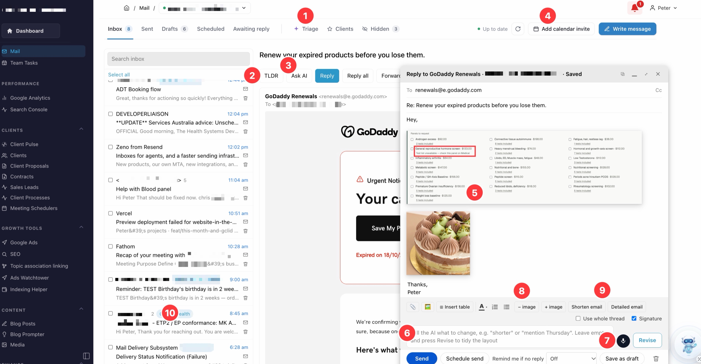

# Mailbox Module

A full Gmail client for **Payload CMS 3 + Next.js 16**: inbox, threads, rich compose, AI drafting and revision, voice drafting, screenshot paste/drop, client matching, calendar invites, scheduled send, follow-up reminders and inbox triage.

It runs as a standalone app (this repo) or drops into an existing Payload + Next.js app as a plugin plus a set of routes.

> [!WARNING]
> **This module does nothing on its own. It needs external services you set up yourself:**
>
> - **A Google Cloud project** with the Gmail API (and optionally the Calendar API) enabled and an OAuth client. Without it, Mail cannot read or send email. → [docs/google-cloud.md](docs/google-cloud.md)
> - **At least one AI provider** (an API key, or one of the subscription OAuth logins) for Write with AI, TLDR, triage and summaries. → [docs/ai-auth.md](docs/ai-auth.md)
> - **OpenAI Realtime access** (a ChatGPT plan via Codex OAuth, or `OPENAI_API_KEY`) for voice drafting.
> - **A scheduler** that calls the cron routes, for scheduled send, follow-up reminders and the daily sync.
>
> Mail reads and sends real email from real accounts. Test with a mailbox you can afford to make mistakes in.

> [!CAUTION]
> The ChatGPT (Codex), xAI Grok and Kimi **subscription OAuth logins reuse those vendors' own CLI OAuth clients** against endpoints that are not public APIs. That may breach the provider's terms, and they can break or revoke it at any time. They are off unless you connect them, each has a kill switch, and API keys work without them. Read [docs/ai-auth.md](docs/ai-auth.md#subscription-oauth-logins-read-this-first) before using them.

## At a glance



The numbers match the screenshot.

1. **Triage inbox.** Only runs when you ask. It never opens your emails: it sorts unread mail by sender and subject line only, and senders who match a client are sorted by code and never sent to the AI. Nothing is archived or marked read until you tick the groups you want and apply.
2. **TLDR.** For long client emails. One click gives a private summary of that one email, suggested actions, questions to ask the sender when something is missing, and a suggested reply.
3. **Ask AI.** For long threads. Ask a question ("what did they agree to on pricing?") and the AI reads that thread and answers, so you don't have to scroll through it. It can't send or change anything.
4. **Google Meet invite in one click.** Pick a time and create the event with a Meet link. Add guests if you want Google to email them; otherwise the Meet link is copied to your clipboard, ready to paste into WhatsApp or a chat for quick ad hoc meetings.
5. **Automatic drop shadow on images.** Paste a screenshot or image and it is sent as a new PNG with a soft drop shadow, kept under 200 KB, so it looks clean in the email and loads fast.
6. **AI email writing.** Write what you want to say in plain English below the email and press Enter. The AI writes the email above it in your own style, set once in **Mail Settings → Writing style** (for example: concise, to the point, casual). Keep prompting to change it.
7. **Voice email writing.** The same thing by voice, over OpenAI Realtime, for when you're out. Talk the email through and it writes and revises the draft, and reads it back when asked. It can never send.
8. **Resize all images at once.** With several images in an email (screenshots of ads for a client, say), **− image** and **+ image** make them all smaller or bigger together, 10% per press, so you don't size each one by hand.
9. **One-click edits.** **Shorten email** or **Detailed email** rewrites the draft. Highlight a line first and only that part changes.
10. **Client tags.** Emails from a client are tagged with that client. With your client list connected, the AI can use that client's details (start date, retainer, goals, what you promised) when you tick *Use client data*, and you can ask questions about everything discussed with them. See [docs/client-list.md](docs/client-list.md).

## Features

- **Inbox, Sent, Drafts, Scheduled, Awaiting reply**: unread first, 45 per page, search with people suggestions, archive, read/unread, labels, attachments and inline images, `.eml` download, open in a new window.
- **Several Gmail accounts per user**, switched from the breadcrumb.
- **Compose**: Gmail-style window with a rich editor (bold/italic/underline, lists, tables, `@` mentions), your Gmail signature, recipient suggestions, schedule send, undo send, "remind me if no reply", autosave to Gmail Drafts, pop-out window.
- **Screenshot paste and drop**: pasted images go inline (sent as `cid:` parts, drop shadow drawn in); files dragged onto the window are attached. 3 MB total per email.
- **AI** (one email at a time, nothing sent without you pressing Send): Write with AI, keep prompting to revise, rewrite a highlighted passage, suggested subject, TLDR with suggested reply, ask about a thread, opt-in whole thread and opt-in client facts, summarise to a client timeline, inbox triage.
- **Voice drafting**: talk the email through over OpenAI Realtime (WebRTC); the agent can only write into and read back the compose window.
- **Clients**: emails are matched to clients by domain/contact; per-client email storage, briefs, questions, alerts for new client email and a dashboard card of unread client email.
- **Calendar**: answer invites (Yes/No/Maybe) straight onto Google Calendar, and create events with a Meet link from Mail.

The full behaviour, rule by rule, is in [docs/features.md](docs/features.md).

## Requirements

- Node.js 24 (see `.nvmrc`) and npm
- A Google Cloud project (see above)
- SQLite file storage locally, or a libSQL/Turso database in production

## Quick start

```bash
git clone <this repo> mailbox-module && cd mailbox-module
npm install
cp .env.example .env
# Fill in the required values (see Configuration below).
npm run dev
```

Open http://localhost:3000, create the first (admin) user, then:

1. **Connect Gmail**: Mail shows a *Connect Gmail* button (or use **AI Auth → Gmail connection**).
2. **Pick an AI model**: **Mail Settings** in the admin (or set `MAIL_AI_MODEL`).
3. Optional: **Google Calendar** global → *Connect Google Calendar*; **AI Auth** → connect a subscription login.
4. Optional: add clients under **Clients** (name, website, contact emails) so emails are matched.

## Configuration

Everything is set with environment variables. Nothing secret is in the code; `.env.example` is the template.

### Required

| Variable | What it is for |
| --- | --- |
| `PAYLOAD_SECRET` | The app's signing secret. Payload signs every login session with it, and Mail signs the Gmail and Calendar sign-in requests with it so a Google sign-in can only ever be saved to the user who started it. Use a long random value (`openssl rand -hex 32`). Changing it logs everyone out. |
| `DATABASE_URL` | Where the app keeps its own data. Your email stays in Gmail; the database holds the users and their logins, each user's Gmail connection (tokens), the client emails Mail files and summarises, scheduled emails, follow-up reminders, notifications and settings. `file:./mailbox.db` is a local SQLite file; on serverless hosts (Vercel and similar) the disk is wiped between requests, so use a hosted libSQL database such as Turso (`libsql://…`) with `DATABASE_AUTH_TOKEN`. |
| `GOOGLE_CLIENT_ID`, `GOOGLE_CLIENT_SECRET` | Your Google Cloud OAuth client. Users sign in to Gmail (and Calendar) through it. See [docs/google-cloud.md](docs/google-cloud.md). |
| `GMAIL_REDIRECT_URI` | Where Google sends users back after signing in: `https://<your app>/api/gmail/callback`. Must be listed exactly in the OAuth client. |
| One AI provider | `ANTHROPIC_API_KEY`, `OPENAI_API_KEY`, `KIMI_API_KEY`, `MINIMAX_API_KEY`, `MIMO_API_KEY` or `XAI_API_KEY`, plus `MAIL_AI_MODEL` set to one of that provider's models (e.g. `claude-sonnet-5.5`). Without one, the AI buttons fail but reading and sending still work. See [docs/ai-auth.md](docs/ai-auth.md). |

### Optional

| Variable | What it is for |
| --- | --- |
| `DATABASE_AUTH_TOKEN` | Token for a hosted libSQL/Turso `DATABASE_URL`. |
| `CRON_SECRET` | Protects the scheduled-job routes below. Needed for scheduled send, "remind me if no reply" and the daily client-email sync. |
| `CRED_ENCRYPTION_KEY` | Only if you connect a subscription login (ChatGPT, Grok or Kimi) on the AI Auth page instead of an API key. Those logins give the app long-lived tokens, which are encrypted with this key before they are stored. 64 hex characters: `node -e "console.log(require('crypto').randomBytes(32).toString('hex'))"`. |
| `MAIL_AI_MODEL` | Default model for every Mail AI feature. Mail Settings in the admin overrides it. |
| `MAIL_ORG_NAME`, `MAIL_ORG_DESCRIPTION`, `MAIL_LANGUAGE` | Who the AI writes for and in which spelling, e.g. `Acme Studio`, `a design studio in Melbourne`, `Australian English`. |
| `MAIL_OWN_DOMAINS` | Your own email domains, comma-separated. They are never treated as a client's domain. |
| `NEXT_PUBLIC_MAIL_TIME_ZONE` | Time zone for business days, schedule send and auto-refresh hours. Default `Australia/Sydney`. |
| `CALENDAR_REDIRECT_URI` | Calendar sign-in return address. Default `https://<your app>/api/calendar/callback`. |
| `GMAIL_ALT_CLIENT_ID`, `GMAIL_ALT_CLIENT_SECRET`, `GMAIL_ALT_DOMAINS`, `GMAIL_ALT_ACCOUNTS` (also `ALT2`, `ALT3`) | Extra Google OAuth clients, only for addresses your main client can't sign in (e.g. another company's Google Workspace). See [docs/google-cloud.md](docs/google-cloud.md#several-workspaces-extra-oauth-apps-optional). |

In-app settings (admins): **Mail Settings** (AI model, house writing style, voice billing), **Google Calendar** (connect a calendar), **AI Auth** (subscription logins, provider status).

## Running

```bash
npm run dev          # http://localhost:3000, schema syncs itself on a file: database
npm test             # Vitest (unit, component and route tests; no network)
npm run typecheck
npm run build && npm start
```

**Database schema.** In development on a `file:` database Payload creates and updates tables itself. Production runs the migrations in `src/migrations` on startup. After changing a collection, run `npm run migrate:create <name>` and commit the new file.

**Scheduled jobs.** Call these with `Authorization: Bearer $CRON_SECRET` (`vercel.json` already declares them for Vercel Cron):

| Route | Schedule | Does |
| --- | --- | --- |
| `GET /api/mail/schedule/tick` | every minute | Sends scheduled emails that are due. |
| `GET /api/mail/follow-ups/cron` | hourly | Raises "no reply yet" reminders. |
| `GET /api/mail/sync/cron` | daily | Syncs client emails for every mailbox, applies the 12-month retention. |

Elsewhere, use any scheduler, e.g. `curl -H "Authorization: Bearer $CRON_SECRET" https://your-app/api/mail/schedule/tick`.

> [!IMPORTANT]
> **Vercel's free (Hobby) plan can't run these schedules.** Hobby only allows cron jobs that run once a day (and only within the scheduled hour), and **a deploy whose `vercel.json` has a more frequent schedule fails**. The `vercel.json` in this repo runs a job every minute and one every hour, so as it stands it only deploys on Vercel Pro or Enterprise. On Hobby, either:
>
> - keep only the daily sync in `vercel.json` (remove the `schedule/tick` and `follow-ups/cron` entries) and call those two routes from an external scheduler (any cron service, or a GitHub Actions schedule) with the `Authorization: [REDACTED] header, or
> - remove the `crons` block entirely and schedule all three externally.
>
> Without the minute job, scheduled emails don't go out; without the hourly job, "remind me if no reply" never fires. Limits are from Vercel's [cron usage and pricing docs](https://vercel.com/docs/cron-jobs/usage-and-pricing), checked October 2026.

**Deploying.** Any Node host that runs Next.js works. Request bodies carry attachments, so the host must accept bodies of at least 4.5 MB (Mail caps them at 3 MB of files). Set every required variable, add the production redirect URIs in Google Cloud, and point a scheduler at the cron routes.

## Project structure

```
src/
  app/(payload)/admin/mail/     Mail page (+ /window pop-out)
  app/(payload)/admin/ai-auth/  AI Auth page
  app/(frontend)/api/mail/      Mail API (inbox, thread, send, AI, voice, sync, crons…)
  app/(frontend)/api/gmail/     Gmail OAuth connect/callback, drafts, status
  app/(frontend)/api/calendar/  Calendar OAuth connect/callback
  app/(frontend)/api/ai-auth/   AI OAuth flows and provider status
  components/mail/              Mail UI (MailApp, ComposeWindow, RichEmailEditor, MailVoice…) and its CSS modules
  collections/, globals/        Payload schema (users, clients, client emails, accounts, settings…)
  lib/mail/                     Mail logic: Gmail transport, matching, storage, prompts, triage, scheduling…
  lib/ai/                       Multi-provider LLM client and AI OAuth
  extensions/client-list.ts     OPTIONAL: hooks into your own client list system
  mailbox/plugin.ts             mailboxPlugin() for Payload configs
  migrations/                   Database migrations
tests/                          Vitest suites
docs/                           Setup and integration guides
```

## Documentation

- [Google Cloud setup](docs/google-cloud.md): project, APIs, consent screen, OAuth client, redirect URIs.
- [AI providers and AI OAuth](docs/ai-auth.md): API keys, subscription logins, voice billing, risks.
- [Calendar and connectors](docs/connectors.md): how Gmail, Calendar, AI and voice connect and what each one does.
- [Integrating into another app](docs/integration.md): plugin, routes, users, access, styling.
- [Client list extension (optional)](docs/client-list.md)
- [Feature reference](docs/features.md)
- [Contributing](CONTRIBUTING.md) · [Security](SECURITY.md)

## License

[MIT](LICENSE). Some ChatGPT (Codex) sign-in code is adapted from gg-framework (MIT); see [THIRD_PARTY_NOTICES.md](THIRD_PARTY_NOTICES.md). Third-party services (Google, OpenAI, Anthropic, xAI, Moonshot/Kimi, MiniMax, Xiaomi) are governed by their own terms; you are responsible for complying with them.
